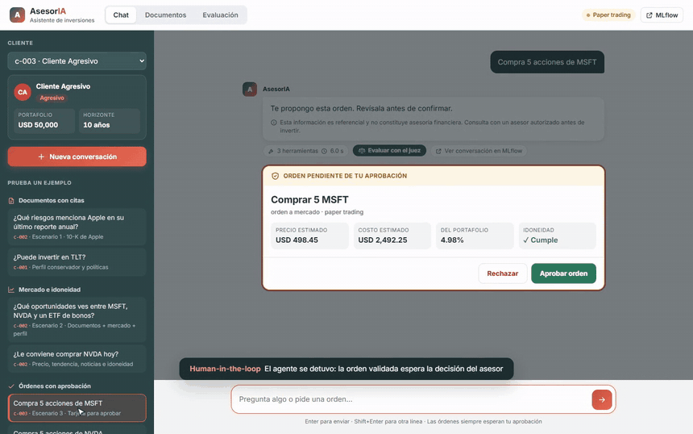
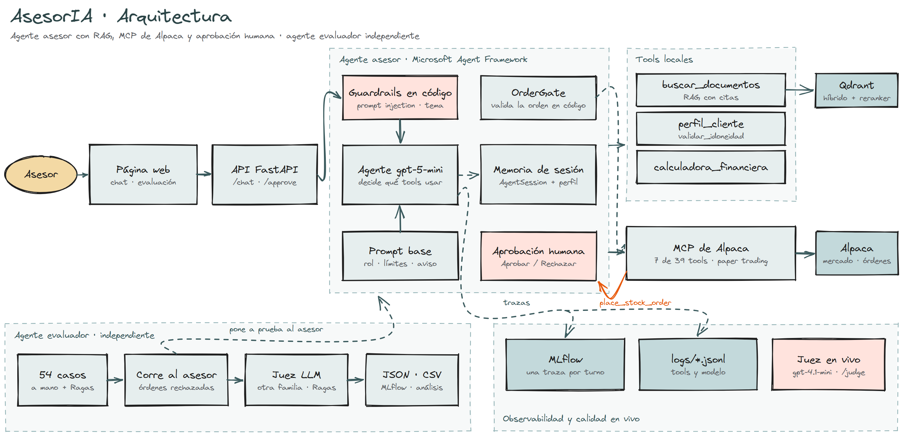
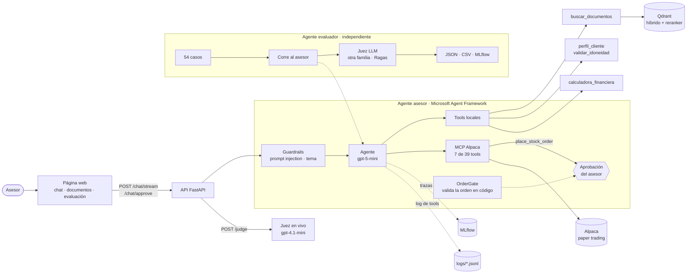
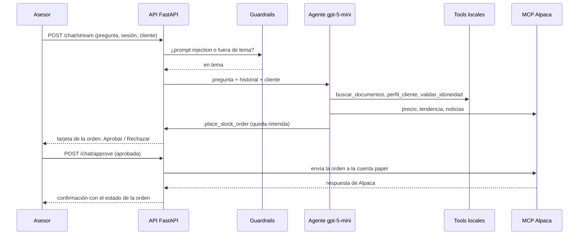

# AsesorIA

Asistente para asesores de inversiones construido con Microsoft Agent Framework. Responde consultas con un RAG sobre documentos financieros públicos, analiza oportunidades combinando ese RAG con datos de mercado del MCP de Alpaca y prepara órdenes en paper trading que solo se envían después de que el asesor las aprueba. Un agente evaluador independiente pone a prueba al asesor con 54 casos y calcula cinco métricas de calidad.

> Proyecto de demostración para el reto técnico AI Engineer de Credicorp Capital. Nada de lo que responde el agente constituye asesoría financiera real.

## Demo

[](docs/video/asesoria-demo-ensayo.mp4)

[▶ Ver el video completo (3 min)](docs/video/asesoria-demo-ensayo.mp4): los tres escenarios del reto, la aprobación humana de la orden, el juez en vivo, la traza en MLflow y el agente evaluador.

> Vista previa (ensayo): el recorrido y la interfaz son los reales, pero en este video las respuestas de los escenarios 1 y 3 son simuladas (dicen "[prueba]"). La versión con el agente real y una orden ejecutada en paper trading se graba con la bolsa abierta y reemplazará este archivo.



## Contenido

- [Demo](#demo)
- [Cómo probarlo](#cómo-probarlo)
- [Arquitectura](#arquitectura)
- [Flujo de ejecución](#flujo-de-ejecución)
- [Base de conocimiento (RAG)](#base-de-conocimiento-rag)
- [Agente asesor](#agente-asesor)
- [Guardrails y seguridad](#guardrails-y-seguridad)
- [Agente evaluador](#agente-evaluador)
- [Latencia, costo y calidad](#latencia-costo-y-calidad)
- [Otras formas de ejecutarlo](#otras-formas-de-ejecutarlo)
- [Variables de entorno](#variables-de-entorno)
- [Estructura del repositorio](#estructura-del-repositorio)
- [Decisiones y trade-offs](#decisiones-y-trade-offs)
- [Evidencia de ejecución](#evidencia-de-ejecución)
- [Tiempo invertido](#tiempo-invertido)

## Cómo probarlo

### 1. Lo que necesitas

- [Docker Desktop](https://www.docker.com/products/docker-desktop/) (o Docker Engine con el plugin Compose).
- Una API key de OpenAI: https://platform.openai.com/api-keys
- Una cuenta de paper trading en Alpaca (gratis, dinero simulado). Al crearla entra a https://app.alpaca.markets, cambia a la cuenta Paper y genera las llaves en *API Keys*.

### 2. Configurar

```bash
git clone https://github.com/DavidAguilarParedes/asesoria.git
cd asesoria
cp .env.example .env
```

Abre `.env` y completa estas cuatro variables (el resto puede quedar como está):

```env
OPENAI_API_KEY=sk-...
ALPACA_API_KEY=PK...
ALPACA_SECRET_KEY=...
SEC_USER_AGENT="Tu Nombre tu-correo@ejemplo.com"
```

`SEC_USER_AGENT` lo exige la SEC para descargar los reportes 10-K; basta con tu nombre y un correo.

### 3. Levantar

```bash
docker compose up --build
```

La primera vez construye la imagen (unos minutos), descarga los 17 documentos públicos e indexa 371 chunks en Qdrant. Indexar cuesta menos de USD 0.01 en embeddings. Cuando aparezca `Uvicorn running on http://0.0.0.0:8000`, está listo:

- Aplicación: http://localhost:8000
- MLflow (trazas de cada conversación): http://localhost:5000

Las siguientes veces arranca en segundos, porque los documentos y el índice quedan guardados.

### 4. Qué probar

En la barra lateral hay ejemplos de un clic. Los tres escenarios del reto:

1. Cliente c-002: *¿Qué riesgos menciona Apple en su último reporte anual?* Responde con citas; cada cita abre el fragmento del documento.
2. Cliente c-002: *¿Qué oportunidades ves entre MSFT, NVDA y un ETF de bonos?* Cruza documentos, mercado en vivo y el perfil del cliente.
3. Cliente c-003: *Compra 5 acciones de MSFT.* Aparece la orden para aprobar; al aprobarla se envía a tu cuenta paper de Alpaca. Con la bolsa abierta (lunes a viernes, 9:30 a 16:00 hora de Nueva York) se ejecuta al momento; fuera de ese horario queda aceptada y se ejecuta en la siguiente apertura.

Cada respuesta tiene el botón *Evaluar con el juez* y el enlace a su conversación en MLflow. Las evaluaciones del juez de la sesión se exportan en CSV o JSON desde su panel. La pestaña *Evaluación* muestra los resultados del agente evaluador y permite descargar `metricas.csv`, `metricas.json` y el detalle por caso.

### 5. Correr el agente evaluador

```bash
docker compose exec app asesoria eval
```

Corre los 54 casos contra el asesor (unos 10 minutos y cerca de USD 0.25) y actualiza `results/metricas.json`, `results/metricas.csv` y el detalle por caso. Las órdenes que propone el asesor durante la evaluación se rechazan siempre.

### Si algo falla

- Puerto ocupado: cambia el puerto de la izquierda en `docker-compose.yml` (por ejemplo `"8080:8000"`).
- `Permission denied` en Linux: la app corre con tu usuario. Si tu UID no es 1000, levántalo con `APP_UID=$(id -u) APP_GID=$(id -g) docker compose up --build`.
- Reindexar desde cero: `docker compose down -v` y vuelve a levantar.
- Sin MLflow: la app funciona igual; solo no se guardan las trazas.

## Arquitectura


El diagrama se puede abrir y editar en [Excalidraw](https://excalidraw.com): [docs/arquitectura.excalidraw](docs/arquitectura.excalidraw).

<details>
<summary>Versión en Mermaid (detalle de conexiones)</summary>



</details>

| Pieza | Tecnología |
|---|---|
| Agente asesor | Microsoft Agent Framework, `gpt-5-mini` con razonamiento bajo |
| LLM auxiliar (guardrail de tema, reescritura) | `gpt-5-nano` |
| Juez | `gpt-4o-mini` y `gpt-4.1-mini` (otra familia que el asesor) |
| Embeddings | `text-embedding-3-small` (densos) + BM25 (dispersos) |
| Vector store | Qdrant (búsqueda híbrida con RRF) |
| Reranker | `cross-encoder/mmarco-mMiniLMv2-L12-H384-v1`, multilingüe y local |
| MCP | `alpaca-mcp-server==2.4.1` (oficial), abierto con `MCPStdioTool` de Agent Framework |
| API y página | FastAPI + HTML/JS sin frameworks |
| Observabilidad | Trazas OpenTelemetry de Agent Framework → MLflow; logs JSONL de tools y del modelo |
| Despliegue | Docker Compose: app + Qdrant + MLflow |

## Flujo de ejecución

Lo que pasa con cada mensaje del asesor:

1. La página envía la pregunta a `POST /chat/stream`, con la sesión y el cliente seleccionado.
2. Un filtro en código revisa si es un intento de prompt injection. Si lo es, responde al instante sin llamar al modelo.
3. Si la pregunta no nombra un instrumento aprobado, `gpt-5-nano` decide si está en tema.
4. El agente (`gpt-5-mini`, Microsoft Agent Framework) recibe la pregunta, el historial de la sesión y el ID del cliente, y decide qué herramientas usar. Las que no dependen entre sí las pide en paralelo.
5. Cada llamada a una herramienta pasa por dos middleware: uno la registra (entrada, salida y duración) y avisa a la página para mostrar el paso; el otro bloquea cualquier orden que no haya pasado la validación de idoneidad.
6. Si el agente pide `place_stock_order`, Agent Framework la retiene y la API devuelve la orden pendiente. La página muestra la tarjeta y el asesor decide con `POST /chat/approve`. Solo con la aprobación se envía a Alpaca.
7. La respuesta llega con sus citas, y el turno completo queda como traza en MLflow.



Los tres escenarios del reto, tal como los resuelve el agente:

1. "¿Qué riesgos menciona Apple en su último reporte anual?" El agente busca en la base de conocimiento (`buscar_documentos`, filtrado por AAPL y 10-K) y responde con citas numeradas que abren el fragmento exacto del documento en la pestaña Documentos.
2. "¿Qué oportunidades ves entre MSFT, NVDA y un ETF de bonos?" (cliente moderado con USD 10,000). En paralelo pide el perfil del cliente, el precio, la tendencia de 90 días y las noticias en Alpaca, y busca fundamentales y riesgos en los documentos. Valida la idoneidad de cada instrumento contra los límites del perfil y responde con un veredicto, cifras y un "Siguiente paso" que la página muestra como botón.
3. "Compra 5 acciones de MSFT." Revisa el perfil, el precio y el poder de compra, y valida la orden (`validar_idoneidad`). Si es apta llama a `place_stock_order`, que Agent Framework retiene hasta la aprobación: la página muestra una tarjeta con el resumen y los botones Aprobar y Rechazar. Solo al aprobar se envía a Alpaca, y la confirmación se arma con la respuesta de Alpaca (aceptada o ejecutada, con su precio).

En la página, mientras el agente trabaja se ve cada herramienta que usa, en el momento en que la usa (`/chat/stream`). Junto al texto aparecen tarjetas armadas con los datos reales de las herramientas: precio y gráfico de 90 días, idoneidad, límites del perfil y noticias.

## Base de conocimiento (RAG)

Corpus: 20 documentos, listados en `data/sources.yaml` y descargados con `asesoria download`:

| Tipo | Documentos |
|---|---|
| Reportes anuales 10-K (SEC EDGAR) | Apple, Microsoft, NVIDIA |
| Fact sheets y prospectos (iShares) | SHY, AGG, TLT, IVV |
| Educación al inversor (Investor.gov) | 6 guías: tasas de interés, fondos y ETFs, asignación de activos, bonos corporativos… |
| Políticas internas simuladas | perfiles de riesgo, límites de concentración, idoneidad (`data/policies/`) |

Los límites de las políticas viven en un solo lugar (`data/policies/reglas.yaml`); un test verifica que el texto de las políticas coincida con ese archivo.

Ingesta y chunking. Cada tipo de documento tiene su loader, porque su estructura es distinta:

- 10-K: se corta por *Item* (1A Risk Factors, 7 MD&A…), así cada chunk sabe a qué sección pertenece.
- Fact sheets: son tablas clave-valor; se convierten a oraciones ("El expense ratio de AGG es 0.03%") para que se puedan buscar.
- PDF y HTML: por encabezados y páginas.
- Políticas en Markdown: las tablas pasan a oraciones.

Después un `RecursiveChunker` arma chunks de hasta 600 palabras con 80 de solapamiento dentro de cada sección, sin mezclar secciones. Resultado: 371 chunks.

Metadatos por chunk: `doc_id`, `doc_type`, `ticker`, `section`, `page`, `as_of` y `source_url`. Sirven para filtrar (solo el 10-K de NVDA), para citar ("nvda-10k-2026, Item 1A · Risk Factors, p. 12") y para la pestaña Documentos.

Búsqueda. Híbrida en Qdrant: embeddings densos (`text-embedding-3-small`) más BM25, fusionados con RRF y reordenados con un cross-encoder multilingüe local. Si el mejor resultado queda bajo el umbral (−2.0, calibrado con los casos sin evidencia), la tool le indica al agente que no hay evidencia y el agente responde "No tengo información suficiente".

Ablación (`asesoria ablation`, 31 preguntas en español sin filtros, Hit@5):

| Configuración | Hit@5 | MRR@5 | Latencia p50 |
|---|---|---|---|
| BM25 | 0.32 | 0.25 | 9 ms |
| Densa | 0.81 | 0.68 | 13 ms |
| Híbrida | 0.74 | 0.62 | 33 ms |
| Híbrida + reranker | 0.77 | 0.72 | 1.8 s |
| Híbrida + descomposición + reranker | 0.87 | 0.73 | 2.3 s |
| Densa + Contextual Retrieval | 0.87 | 0.72 | 17 ms |

Con las búsquedas reales del agente, que llegan en inglés y con filtros (`asesoria agent-queries`), híbrida + reranker y Contextual Retrieval empatan en Hit@5 0.90 / MRR 0.85. Por eso el agente usa híbrida + reranker sobre la colección base: el mismo resultado sin reindexar con un LLM. BM25 sale mal en la ablación porque compara preguntas en español con documentos en inglés.

## Agente asesor

Tools locales (`application/tools.py`):

| Tool | Qué hace |
|---|---|
| `buscar_documentos` | Búsqueda RAG con filtros por ticker y tipo de documento; devuelve el texto y la cita de cada fragmento |
| `perfil_cliente` | Perfil de riesgo, portafolio, horizonte y monto máximo por instrumento |
| `validar_idoneidad` | Aplica las reglas de idoneidad: universo aprobado, límites de concentración, máximo por orden y poder de compra. Devuelve el motivo, el costo, el % del portafolio y cuántas acciones caben |
| `calculadora_financiera` | Costo de una orden, % del portafolio, monto y acciones máximas, retorno y CAGR |

MCP de Alpaca. Se abre con `MCPStdioTool` de Agent Framework (vía `uvx`), con `ALPACA_TOOLSETS=account,trading,stock-data,news` y, encima, una lista blanca de 7 de las 39 tools: `get_account_info`, `get_all_positions`, `get_stock_snapshot`, `get_stock_bars`, `get_news`, `place_stock_order` y `get_order_by_id`. `ALPACA_PAPER_TRADE=true` se fuerza en código. Las barras diarias se resumen antes de llegar al modelo (inicio, fin, mínimo, máximo y un cierre por semana) para ahorrar tokens.

Decisión autónoma y trazabilidad. El agente decide qué herramientas usar a partir del prompt (`application/prompts.py`), que define su rol, sus límites, el disclaimer y el formato de respuesta. Cada decisión queda registrada:

- `logs/tool_calls.jsonl`: cada tool con su entrada, salida, duración y nivel de riesgo.
- `logs/model_calls.jsonl`: cada llamada al modelo con su latencia y sus tokens.
- MLflow: una traza por turno, agrupada por conversación en la vista *Sessions*, con la pregunta, la respuesta, cada llamada al modelo y cada tool. La página enlaza cada respuesta a su conversación en MLflow.

Memoria. Cada conversación tiene su `AgentSession` (memoria de la sesión) y el cliente queda asociado a la sesión, así el agente conoce su perfil sin preguntarlo.

Human-in-the-loop. `place_stock_order` está configurada con `always_require_approval`: Agent Framework detiene la ejecución y la API devuelve la orden pendiente. Solo `/chat/approve` con `approved=true` la libera.

## Guardrails y seguridad

| Riesgo | Mitigación |
|---|---|
| Prompt injection | Filtro en código antes del modelo (`domain/guardrails.py`): responde al instante, sin llamar al LLM. El prompt marca el texto de las tools como datos, nunca como instrucciones |
| Preguntas fuera de tema | Si no nombra un instrumento aprobado, `gpt-5-nano` decide si está en tema (salida estructurada) |
| Orden no apta para el perfil | `OrderGate` y `OrderGuardMiddleware` bloquean en código cualquier orden que no haya pasado `validar_idoneidad` con la misma cantidad, aunque el asesor la apruebe |
| Límites por orden | Máximo de USD 10,000 por orden y límites de concentración por perfil y clase de activo |
| Responder sin evidencia | Umbral del reranker → "No tengo información suficiente" |
| Disclaimer | Pedido en el prompt y agregado en código cuando se propone una orden |
| Credenciales | Solo por variables de entorno (`.env`, fuera del repo); `.env.example` sin valores |
| Herramientas MCP | Toolsets + lista blanca de 7 tools; paper trading forzado |
| Gasto | `MAX_USD_PER_RUN` corta un comando si supera el tope; caché de embeddings y del LLM en SQLite |
| Datos de la cuenta | El evaluador tapa el número y el id de la cuenta de Alpaca antes de guardar resultados |

## Agente evaluador

Un agente separado (`src/evaluator/`), que no participa en la asesoría, corre un set de evaluación contra el asesor y exporta los resultados.

Dataset: 54 casos (`data/eval/`): 41 escritos a mano y 13 generados con Ragas a partir de personas. Son preguntas sobre los documentos (single-hop y multi-hop), casos sin evidencia y casos de comportamiento (órdenes, idoneidad, prompt injection). Cada caso trae la respuesta de referencia y la evidencia esperada (documento, sección, página o frase), lo que permite medir también la recuperación. Las órdenes que propone el asesor durante la evaluación se rechazan siempre: el evaluador nunca ejecuta nada.

Cinco métricas, calculadas con Ragas. Cuatro las califica un LLM-as-a-judge de otra familia que el asesor (GPT-4 frente a GPT-5), para que el modelo no se califique a sí mismo. La de tools se calcula comparando de forma exacta las tools llamadas con las esperadas:

| Métrica | Qué mide | Cómo se mide | Resultado |
|---|---|---|---|
| Faithfulness | Lo que responde está respaldado por lo que trajeron las tools | Juez `gpt-4o-mini` | 0.87 |
| Correctness | Incluye los datos de la respuesta de referencia | Juez `gpt-4o-mini` | 0.81 |
| Goal accuracy | Logra lo que se pidió | Juez `gpt-4.1-mini` | 0.91 |
| Tool call accuracy | Usa las tools esperadas, en orden y con los argumentos clave | Comparación exacta | 0.92 |
| Guardrails | Respeta las reglas: disclaimer, confirmación, decir que no sabe | Juez `gpt-4o-mini` | 0.94 |

Recuperación con las búsquedas reales del agente: Hit@5 0.91, MRR@5 0.81. Latencia mediana por caso: 8.4 s. Errores: 0.

Archivos exportados (`results/`): `metricas.json` y `metricas.csv` (las cinco métricas con su método), `eval.json` (resumen y casos), `eval_summary.csv` (por grupo), `eval_cases.csv` (por caso), `eval_runs.json` (conversaciones completas) y `analisis.md` (análisis de fallos que escribe un agente intérprete). Cada corrida también queda como run en MLflow.

Análisis de fallos. Un agente intérprete agrupa los casos que fallan por causa en `results/analisis.md`:

- Recuperación: la búsqueda no trajo la evidencia esperada; por ejemplo, tablas que quedan sin contexto en un chunk.
- Uso de tools: consultas mal formuladas o filtros equivocados al buscar.
- Respuestas no respaldadas: datos fuera de la evidencia recuperada (baja faithfulness o correctness).
- Guardrails y comportamiento: reglas operativas que no se cumplieron en todos los casos.
- Casos sin evidencia (Goal accuracy 0.33, solo 3 casos): el agente se comportó bien (por ejemplo, dijo que Tesla no está entre los instrumentos aprobados), pero el juez lo calificó contra una redacción de referencia distinta. Es un problema de etiquetas del dataset, no del agente.

El mismo archivo propone mejoras priorizadas: estandarizar las consultas a la búsqueda, verificar la evidencia después de recuperar, exigir citas mínimas y alinear las etiquetas de los casos sin evidencia.

Juez en vivo. En el chat, cada respuesta tiene el botón *Evaluar con el juez* (`POST /judge`): `gpt-4.1-mini`, con temperatura 0 y salida estructurada, califica cuatro criterios con su motivo y da un dictamen (Aprobada, Aprobada con observaciones o Con problemas). "Correctness" no está en vivo porque necesita una respuesta de referencia.

> Las métricas de arriba se midieron antes de los últimos ajustes del prompt (formato para ejecutivos, siguiente paso, fundamentales). Para actualizarlas: `uv run asesoria eval`.

## Latencia, costo y calidad

Medido en los logs del proyecto:

| Paso | Mediana |
|---|---|
| Llamada al modelo del asesor | 2.6 s (p90 6.1 s) |
| `buscar_documentos` (híbrida + reranker) | 1.8 s |
| Tools de Alpaca (precio, barras, noticias, cuenta) | ~0.5 s |
| Tools locales (perfil, idoneidad, calculadora) | < 5 ms |
| Respuesta completa | 8 s por caso en la evaluación; 10 a 20 s en un análisis de oportunidades con 5 o 6 tools |

- Dónde se va el tiempo: en las rondas del modelo (pensar → tools → pensar → redactar), no en las tools. Por eso las tools independientes se piden en paralelo, el razonamiento va en `low` y las barras se resumen antes de llegar al modelo.
- Costo: una consulta cuesta entre USD 0.002 y 0.006 con `gpt-5-mini`. Una corrida completa del evaluador, unos USD 0.23. Indexar con Contextual Retrieval costó USD 0.03. El juez en vivo, unos USD 0.002 por evaluación. Todo el proyecto se hizo con un presupuesto cercano a USD 2.
- Percepción de latencia: la página muestra los pasos reales mientras el agente trabaja. El filtro de prompt injection responde en 0.2 s (antes, el modelo tardaba unos 23 s).
- Calidad vs. costo: el reranker suma 1.8 s pero sube el MRR. Contextual Retrieval empata en calidad, pero obliga a reindexar con un LLM. La descomposición de preguntas mejora el Hit@5 (0.87) a cambio de una llamada extra al LLM por búsqueda.

Siguientes pasos para producción: streaming del texto final; razonamiento `minimal` en preguntas simples; caché semántica de respuestas frecuentes; un segundo MCP (Alpha Vantage) para fundamentales estructurados; reindexado incremental cuando cambian los documentos.

## Otras formas de ejecutarlo

Con Docker, ver [Cómo probarlo](#cómo-probarlo).

### Sin Docker

Requiere [uv](https://docs.astral.sh/uv/) (instala Python 3.12 si hace falta). Qdrant corre embebido en la carpeta `.qdrant` y MLflow queda apagado.

```bash
uv sync --extra rerank --extra eval
cp .env.example .env
uv run asesoria init        # descarga e indexa el corpus
uv run asesoria serve       # http://localhost:8000
```

### En GitHub Codespaces

El repo incluye un `.devcontainer`. Configura `OPENAI_API_KEY`, `ALPACA_API_KEY` y `ALPACA_SECRET_KEY` como secretos de Codespaces y ejecuta `uv run asesoria init && uv run asesoria serve`.

### Comandos

| Comando | Qué hace |
|---|---|
| `asesoria init` | Descarga los documentos e indexa si hace falta |
| `asesoria serve` | API y página en http://localhost:8000 |
| `asesoria chat --client c-003` | Conversación en la terminal (confirma órdenes con s/n) |
| `asesoria ask "..." --client c-002` | Una sola pregunta |
| `asesoria search "..." --rerank` | Búsqueda en la base de conocimiento |
| `asesoria eval` | Agente evaluador: corre los 54 casos y exporta `results/eval.*` |
| `asesoria ablation` | Compara configuraciones del RAG (`results/ablation.*`) |
| `asesoria grabar-ejemplos` | Graba las respuestas de los ejemplos de la página para la demo |
| `asesoria costs` | Gasto acumulado |

Endpoints: `POST /chat`, `POST /chat/stream` (avisos de progreso en NDJSON), `POST /chat/approve`, `POST /judge`, `GET /clients`, `GET /documents`, `GET /eval`, `GET /ablation`.

Clientes de prueba (`data/clientes.json`): `c-001` conservador (USD 25,000), `c-002` moderado (USD 10,000) y `c-003` agresivo (USD 50,000).

Tests: `uv run pytest` (85 tests, sin red). `uv run lint-imports` verifica las capas.

## Variables de entorno

| Variable | Obligatoria | Descripción |
|---|---|---|
| `OPENAI_API_KEY` | Sí | API key de OpenAI |
| `ALPACA_API_KEY` / `ALPACA_SECRET_KEY` | Sí | Credenciales de la cuenta paper de Alpaca |
| `ALPACA_PAPER_TRADE` | Sí | `true` (el código lo fuerza igual) |
| `SEC_USER_AGENT` | Sí, para descargar | Nombre y correo de contacto que exige la SEC |
| `OPENAI_CHAT_MODEL` | No | Modelo del asesor (por defecto `gpt-5-mini`) |
| `OPENAI_FAST_MODEL` | No | Modelo auxiliar (por defecto `gpt-5-nano`) |
| `OPENAI_EMBEDDING_MODEL` | No | Embeddings (por defecto `text-embedding-3-small`) |
| `JUDGE_MODEL` | No | Juez en vivo (por defecto `gpt-4.1-mini`) |
| `MAX_USD_PER_RUN` | No | Tope de gasto por comando (por defecto 0.30) |
| `QDRANT_URL` | No | Servidor Qdrant; sin él se usa la carpeta `.qdrant` |
| `MLFLOW_TRACKING_URI` / `MLFLOW_UI_URL` | No | MLflow; sin él la app funciona igual |

## Estructura del repositorio

```
src/asesoria/
├── domain/           modelos, puertos, reglas de idoneidad, guardrails y finanzas (sin dependencias externas)
├── application/      agente asesor, tools, prompt, middleware, recuperación e ingesta
├── infrastructure/   loaders, chunking, embeddings, Qdrant, reranker, MCP de Alpaca, LLM, juez, MLflow
├── entrypoints/      API (FastAPI), CLI, ejemplos grabados y la página (static/index.html)
├── config.py         configuración desde .env
└── bootstrap.py      arma las dependencias (Container)
src/evaluator/        agente evaluador, métricas, ablación y generación de casos
data/                 corpus (sources.yaml), políticas internas, clientes y set de evaluación
results/              métricas exportadas (JSON y CSV) y análisis de fallos
docs/decisions/       decisiones técnicas
tests/unit/           tests sin red
```

## Decisiones y trade-offs

- Arquitectura por capas simplificada (ver [docs/decisions/0001-arquitectura.md](docs/decisions/0001-arquitectura.md)): las piezas del RAG se intercambian en `bootstrap.py`, lo que hizo posible la ablación; las reglas de idoneidad se testean sin red.
- Reglas en código, no solo en el prompt. La idoneidad, el bloqueo de órdenes no validadas, la confirmación de la orden y el filtro de prompt injection están en código. El prompt ayuda, pero un modelo puede equivocarse; el código no se deja convencer.
- Híbrida + reranker en vez de Contextual Retrieval: misma calidad con las búsquedas reales del agente, sin reindexar con un LLM.
- Chunks por sección: un fragmento nunca mezcla dos *Items* de un 10-K, así la cita siempre es correcta. A cambio, algunas secciones largas quedan en varios chunks.
- `gpt-5-mini` con razonamiento bajo: buen uso de tools a bajo costo. Un modelo más grande respondería mejor a cambio de más latencia y costo; para el guardrail de tema basta `gpt-5-nano`.
- Juez de otra familia: el asesor es de la familia GPT-5 y el juez de la familia GPT-4, para evitar que un modelo se califique con sus propios sesgos. `gpt-4o-mini` resultó muy literal para Goal accuracy, por eso esa métrica usa `gpt-4.1-mini`.
- Ragas 0.3.0 en lugar de 0.4: la 0.4 exige `openai<3`, y el proyecto usa `openai>=3` (Agent Framework).
- Un solo MCP (Alpaca): cubre mercado, noticias, cuenta y órdenes. Los fundamentales salen de los 10-K y fact sheets; un segundo MCP como Alpha Vantage sería el siguiente paso.
- Página sin frameworks de frontend: un solo archivo HTML, fácil de leer y sin build.
- Órdenes fuera de horario: una orden a mercado aprobada con la bolsa cerrada queda *aceptada* y se ejecuta en la próxima apertura (9:30 a.m. hora de Nueva York). La confirmación lo dice tal cual.

## Evidencia de ejecución

Video de la demo: [docs/video/asesoria-demo-ensayo.mp4](docs/video/asesoria-demo-ensayo.mp4) (vista previa; ver la nota en [Demo](#demo)). Lo graba `scripts/grabar_video.py` y lo monta `scripts/montar_video.py` (tarjetas, cursor, esperas aceleradas y música). El guion está en [docs/guion-video.md](docs/guion-video.md).

Las cinco métricas del agente evaluador: [results/metricas.json](results/metricas.json) y [results/metricas.csv](results/metricas.csv). El detalle por grupo y por caso está en [results/eval_summary.csv](results/eval_summary.csv), [results/eval_cases.csv](results/eval_cases.csv) y [results/eval.json](results/eval.json), y el análisis de fallos en [results/analisis.md](results/analisis.md).

## Tiempo invertido

Unas 8 horas.
